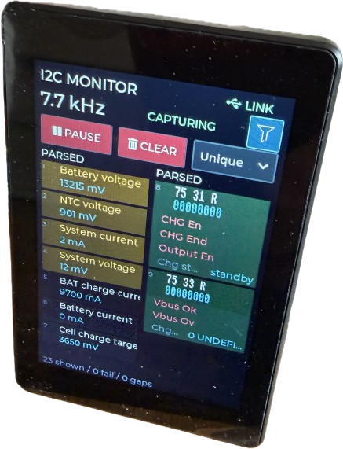
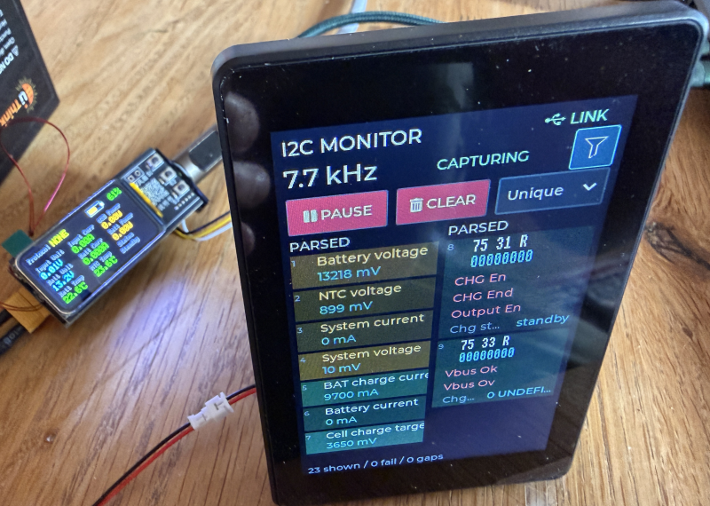
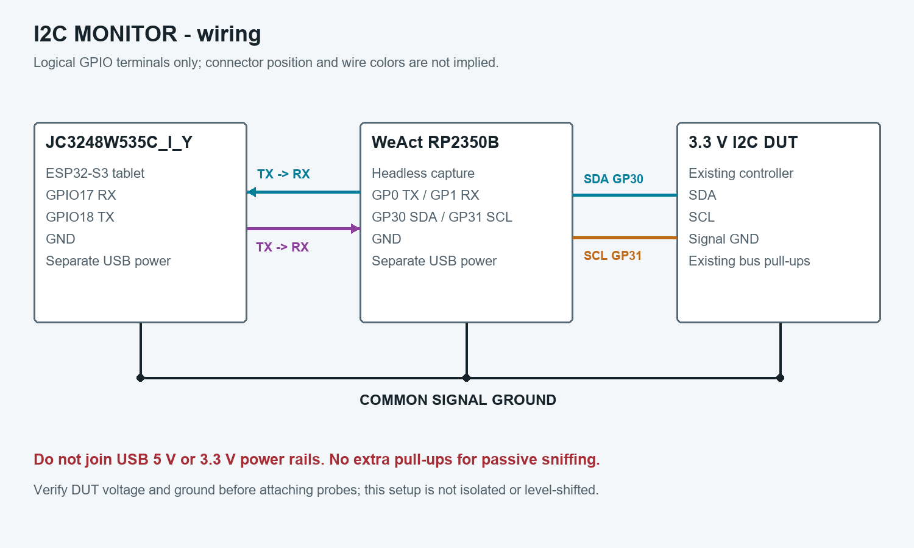
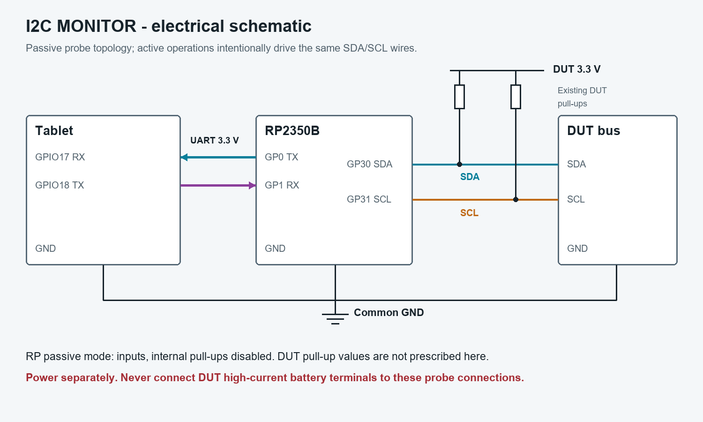
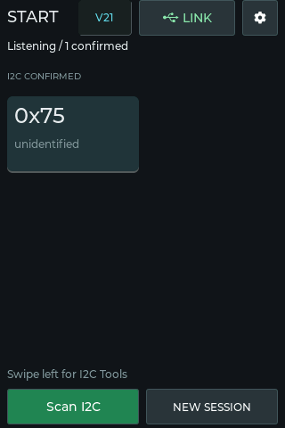
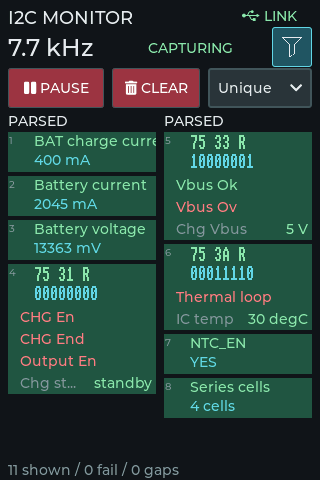
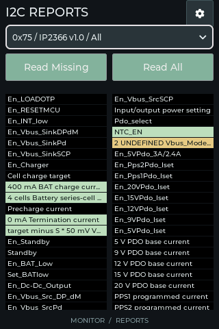
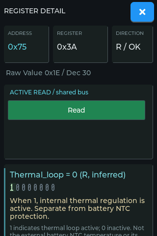
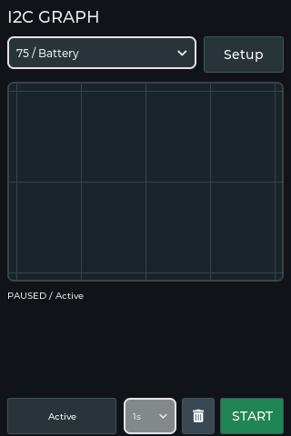
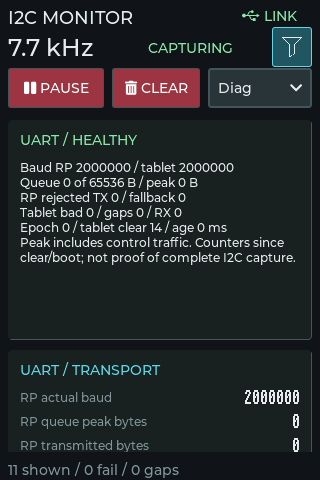

# I2C MONITOR

## Overview

I2C MONITOR is an instrument for observing, understanding, diagnosing and experimenting with I2C devices. In many cases, this device can completely replace expensive oscilloscopes and complex signal analyzers.

It consists of two parts:

* **I2C Sniffer:**     
  A simple RP2040 or RP2350 performs the wire tapping and only requires a few wires and no extra components. When you connect it to a PC via its USB-C connector, you can use [PowerShell scripts](https://github.com/TobiasPSP/digiscan/tree/main/tools) to display its readings, filter, parse, and much more.    
* **ESP32-S3 Tablet Front-End:**   
  For portable use, add a *Guition ESP32-S3 3.5" tablet* and connect it to the UART interface of the Raspberry. This setup runs without PC stand-alone. The tablet has built-in battery support.

To sniff and experiment, connect the Raspberry I2C interface to your I2C device that you want to test.

This is what the full setup looks like:



The tablet is fully optional. Without the tablet, use your PC and the provided PowerShell scripts.

### Signal Acquisition

A headless RP2350 captures the bus and acts as a **passive** I2C sniffer: it uses high-impedance inputs and does not interfere with the I2C bus under test, much similar to how an oscilloscope or signal analyzer work. 

It can also actively write the bus. Make sure you add pullup resistors yourself if you want to work with isolated I2C components that do not yet have their own I2C master.


### Monitoring
Monitoring is passive by default; scans, requested reads, writes and playback are explicit active operations that are performed with careful collision detection to minimize interference with existing I2C masters.

### Parsing
By default, the sniffer provides you with the I2C transactions. By adding editable chip profiles, these transactions can be automatically translated into meaningful text.




The project comes with profile files for IP2366, IP2368, and IP2369. Editable chip profiles make the instrument extensible without rebuilding its firmware.

## Firmware

Full source code is provided in the folder [sourcecode](https://github.com/TobiasPSP/digiscan/tree/main/sourcecode). 

For the Raspberry, [compiled firmware](https://github.com/TobiasPSP/digiscan/tree/main/firmware) is available for RP2350 and RP2040. Note that RP2350 and RP2040 use different GPIO assignments for the I2C sniffer cable and UART.


## Software
* If you use a ESP32-S3 tablet via UART, no additional software is required. The complete software part is integrated into the [tablet firmware](https://github.com/TobiasPSP/digiscan/tree/main/sourcecode/Tablet).

* If you use the Raspberry stand-alone, use the provided PowerShell scripts in [tools](https://github.com/TobiasPSP/digiscan/tree/main/tools).
  
### PC Software

The RP2350 can be controlled from a PC via UART-Serial and i.e. PowerShell scripts. Uploading new custom profiles is supported.


### Features

- **Automatic bus discovery:** START listens for valid I2C traffic and lists confirmed device addresses. An optional active scan finds additional responding addresses, skipping those already confirmed passively.

- **Live transaction monitoring:** Sniff shows incoming register transactions, while Unique maintains one entry per address/register pair. Fading highlights distinguish new or changed values from repeated, unchanged polls.

- **Interactive discovery and filtering:** Discover asks whether to keep or ignore each newly encountered register or complete parsed register group. Address, register and read/write filters help isolate rare interactions from routine polling without hiding unknown registers from discovery.

- **Device-aware decoding:** YAML profiles describe register groups, bit fields, enumerations, units, formulas and friendly explanations. Raw, Parsed and Both views expose either the original bytes, interpreted properties, or both, with detailed explanations available by tapping an entry.

- **Collected reports:** Profile-defined reports gather readable properties passively and retain their values independently of the live transaction list. Read Missing, Read All and individual Read buttons actively fill gaps or refresh measurements, restoring the previous capture state afterwards.

- **Graphs:** Predefined or manually selected properties can be plotted from passively observed measurements. Active graph mode instead performs periodic reads at a configurable refresh interval, with explicit start/stop controls.

- **Manual reads and writes:** Dedicated screens query registers without a profile and prepare one- or multi-byte writes in several input formats. Register prefixes, read lengths, endianness and output formats support exploring unfamiliar devices, subject to the active-operation safety limits below.

- **Write recording and playback:** Recorder captures filtered writes in order and lets individual entries be excluded from playback. Replay approximates their relative timing, checks supported fault registers, and then watches for host writes that revert the applied settings.

- **Identification and reusable profiles:** Identification evaluates chip-specific, exclusion and shared-register evidence rather than treating every response as a unique match. IP2366, IP2368 and IP2369 profiles are included, and additional definitions can be converted and installed through the bundled PowerShell module.

- **Diagnostics and session management:** Diagnostics expose bus timing estimates, capture faults, UART health, queues and reported losses. New Session clears temporary investigation data, while Reset Configuration also clears saved assignments/settings without deleting installed chip profiles.


## Parts List

| Part | Purpose |
| --- | --- |
| WeAct RP2350B, RP2350B0A4, 16 MB flash | Headless capture and active transactions; companion `rp2350-sniffer-v13` firmware |
| Guition JC3248W535C_I_Y | ESP32-S3 tablet, 320 x 480 LCD and capacitive touch; this firmware |
| Two USB data/power cables | Power and firmware upload for the two boards |
| Three short UART wires | TX, RX and common ground |
| Three insulated probes | SDA, SCL and DUT ground |
| Optional connector/pigtail | Tablet GPIO17/18 and ground; verify signals, not wire colors |
| 3.3 V I2C DUT with existing pull-ups | Device/bus under investigation |

The tablet is a separate frontend, not the bus sampler. An SD card, Wi-Fi connection, USB/UART adapter and external TFT are not required.

### Choose The Correct RP2350 Silicon

Generally, it is recommended to use a RP2350 over a RP2040 because the RP2350 provdies more headroom, both in speed and memory. However, if you opt for a RP2350, make sure you use a **recent hardware revision**. The initial RP2350 MCUs had a hardware flaw that can affect this project. 

Use an **A4-stepping** board for this build, with the chip marked **RP2350B0A4**. Early **A2** silicon has GPIO erratum RP2350-E9: input pads can exhibit unwanted leakage instead of behaving as clean high-impedance probes. That is particularly undesirable on a passive I2C instrument. A4 fixes E9, although it does not eliminate every RP2350 erratum. Ask the seller for a photo of the actual chip marking and inspect the delivered part; a listing saying only "RP2350B" or "new version" is not sufficient. The **B** identifies the 48-GPIO package variant, not the silicon stepping; the final **A4** is what to check. This wiring/binary requires that B-package board because it uses GP30/31. See Raspberry Pi's [A4 announcement and marking guidance](https://www.raspberrypi.com/news/rp2350-a4-rp2354-and-a-new-hacking-challenge/).

## Wiring



| From | To | Function |
| --- | --- | --- |
| RP2350 GP0, TX | Tablet GPIO17, RX | Transactions and diagnostics |
| RP2350 GP1, RX | Tablet GPIO18, TX | Commands and acknowledgements |
| RP2350 GND | Tablet GND | UART reference |
| RP2350 GP30 | DUT SDA | Passive probe; active operations use the same pin |
| RP2350 GP31 | DUT SCL | Passive probe; active operations use the same pin |
| RP2350 GND | DUT GND | I2C reference |

These are **GPIO numbers, not connector pin positions**. Check the tablet connector against its board documentation and continuity measurements. The diagram shows logical terminals, not a physical board pinout.



Power both boards through separate USB connections. **Do not join their 5 V or 3.3 V rails.** UART is 3.3 V logic, not RS-232. Ground probes go to signal ground, not DUT battery/power terminals. Verify ground and signal voltage before attaching probes. This is not an isolated or level-shifting interface; do not directly attach 5 V or unknown-voltage signals. Keep wires short for the 2 Mbaud link.

Passive capture disables RP probe pull-ups. Existing DUT pull-ups stay in place; do not add extra pull-ups to an already functioning bus. Active reads, scans, writes and playback temporarily drive these same DUT lines. Idle-bus checks reduce interference but cannot guarantee exclusivity when another master is present. Experimental writes are unsuitable for safety-critical hardware.

Display/touch wiring is internal to the tablet: AXS15231B QSPI display and touch on GPIO4/8 at address 0x3B. Do not connect the DUT to the internal touch bus.

## Build And Upload

Open this folder in VS Code/PlatformIO and build/upload environment `tablet`. Dependencies are pinned: espressif32 6.12.0, Arduino GFX 1.5.9 and LVGL 9.2.2.

```powershell
platformio run -e tablet
platformio run -e tablet -t upload
```

Output is `.pio/build/tablet/firmware.bin`; build artifacts are deliberately not published and PlatformIO recreates them. The RP2350 uses the compatible companion V13 headless firmware, with GP30/31 probes and GP0/1 UART; update both boards to use the accelerated read batches. UART starts at 115200 and negotiates 2 Mbaud with monitored fallback.

### RP2350 Firmware Download

[Download the matching RP2350 V13 UF2](firmware/rp2350-sniffer-v13-weact-rp2350b.uf2). This is the **WeAct RP2350B headless** build, not an RP2040 or tablet image. Hold BOOT while resetting/connecting the RP board, then copy the UF2 onto its bootloader USB drive. It restarts after installation. Use a USB data cable. Disconnect DUT probes while installing/changing wiring; reconnect after verifying the board and pin assignments. The accompanying SHA-256 file identifies the published binary.

## Start And Sessions

The header shows the tablet firmware revision beside START. Boot always opens **START**, synchronizes the RP link and starts unrestricted passive discovery. Valid traffic or a successful scan adds address tiles. Failed traffic alone cannot confirm an address. Once I2C is confirmed, the swipe hint appears and the other screens unlock. Tap an address tile to identify/assign a profile. Shared-register evidence is not a unique chip ID; ambiguities require a user choice. **Scan I2C** searches remaining addresses, skipping confirmed ones.



**NEW SESSION** clears temporary observations, filters, reports, graphs, recordings and diagnostics, while preserving assignments/settings. The gear menu's **RESET CONFIGURATION** additionally clears saved assignments/settings. Both require confirmation and retain installed chip definitions. Neither writes DUT settings. Reconnect preserves data and synchronizes state without blindly replaying commands.

## Screens And Features

Swipe between START, MONITOR, REPORTS, GRAPH, RECORDER, READ and WRITE.

### Monitor

Run/Pause controls capture; Pause freezes presentation fades. Clear resets observations/diagnostics and preserves the requested running state. Sniff shows received transactions; Unique keeps one entry per address/register with Latest Transaction or Latest Change ordering. New/changed values fade orange; unchanged successful polls pulse green. Recent change groups are sorted for readability.

The filter selects addresses, registers, R/W and Raw/Parsed/Both presentation. The change factor scales profile `atomic_step`; zero disables hysteresis and is the default. Tap an entry for full raw/decoded details and profile assignment.



Discover pauses on an undecided property/register group and offers Keep/Ignore with parsing details. Multi-register properties are reviewed together; unknown registers remain candidates. Decisions build a temporary filter that persists across Monitor view changes. Clear in Discover clears the decisions; an empty decision set never suppresses discovery.

### Reports And Details

Reports collect profile-defined properties passively. Unseen values stay empty; successful values settle green, false booleans reddish, failures white/red. Later successful observations recover failed values. Read Missing, Read All and per-property Read actively acquire values and restore the previous capture state. Cancel stops a batch. Property details include raw values, visual bitmasks, friendly descriptions, access, formulas and technical masks/shifts. Address/profile bindings persist and can be changed from details.




### Graph

Choose a predefined graph or Manual and select parsed properties. The footer cycles Passive, Passive/Active and Active acquisition, with a 1-30 second interval. START/STOP controls graph acquisition and plotting; the trash icon clears history. Graphs reboot paused. Property units come from profiles; normalization is presentation, not conversion.




#### V22 Acquisition Refinements

Use the matching RP2350/RP2040 V13 firmware for accelerated Reports and Graph reads. Both now share bounded property-read batches: synchronization is retained across the batch, while every byte still requires bus-idle admission and physical pin release. Arbitration loss, interference, uncertain restoration and timeouts stop the batch. No automatic read retries, extra pull-ups or faster I2C clock are used.

GRAPH's footer contains an acquisition-mode button, a 1-30 second interval, a trash icon that clears only graph history, and START/STOP. The trash icon preserves property selections, interval, mode and running/paused state. START explicitly enables acknowledged capture/delivery for passive acquisition; STOP freezes the graph and cancels pending graph reads without stopping other consumers' passive monitoring. Graphs still start paused after a reboot.

- **Passive:** plot captured values; no active reads. The interval dropdown is disabled because acquisition follows observed bus traffic. Tap the mode button to choose Passive/Active or Active and enable the interval dropdown.
- **Passive/Active:** at each interval, read only selected properties lacking a successful passive observation younger than that interval. Active replies do not count as fresh passive observations.
- **Active:** read all selected properties at each interval. Shared register fields are read once per cycle; their values update all corresponding fields.

The interval is measured from completion of a read cycle, preventing overlapping requests. The chart's 10 Hz presentation grid remains independent of acquisition. Manual Setup now selects properties only; acquisition controls remain visible in the footer. With older RP firmware, the existing individual-read path remains available, but lacks the batch speed improvement.

### Recorder

Records replayable writes, including identical repeats, using the current filter or a preset. START becomes DONE; checked writes can then be played back. Playback preserves order and relative timing as closely as idle-bus arbitration allows, skipping the initial idle delay. Supported fault-register checks abort on faults. It watches played registers for five seconds afterwards to expose reverting host writes. Playback is experimental, not a hard-real-time waveform generator.

### Read And Write

READ supports manual register lists, lengths, endianness and output formats without a profile. WRITE supports register prefixes and one-/multi-byte payload formats. Both actively drive the bus; verify the target and payload before writing.

### Diagnostics

Diag consolidates baud/link health, queues, losses, capture faults and timing. Clock estimates use valid-frame timing, not proof of I2C compliance. Delivered transaction counts cannot prove that every physical edge was sampled.



## Profiles And Tools

`profiles` includes IP2366, IP2368 and IP2369 YAML sources and provenance notes. Compiled fallbacks are included; runtime definitions can replace/extend them. Profiles define registers, masks, units, formulas, enumerations, friendly text, reports, graphs, identification evidence and recorder filters. References resolve at runtime, including uploaded profiles. Uncertainties remain documented in YAML.

```powershell
Import-Module .\tools\I2CMonitor\I2CMonitor.psd1
Publish-Profile .\profiles\ip2366.yaml
Get-TabletProfiles | Format-Table
```

The self-contained module supports Windows PowerShell 5.1 and bundles YAML DLLs. Auto COM detection prompts if ambiguous. Replacing a chip always warns, even at the same version; `-Force` enables unattended replacement. Installation validates, pauses capture, uploads acknowledged chunks, verifies storage and reboots. Use the **tablet USB port**, not the RP2350 or UART bridge.

See [tools/README.MD](tools/README.MD), [PROFILE-FORMAT.md](PROFILE-FORMAT.md) and [REPORT-SCHEMA.md](REPORT-SCHEMA.md).

## Implementation And Validation

`src/main.cpp` owns hardware initialization, scheduling, packet dispatch and UI composition. `include/*_ui.h` implements screens; other headers hold bounded decoding, protocol, acquisition, storage and presentation models. Generated headers are fallback data. Large buffers use PSRAM; bounded UART processing shares the main loop with touch/LVGL. Vendor licenses remain in `licenses` and the module.

Screenshots use the actual LVGL UI with deterministic mock traffic. They show layout, not physical touch/display/UART validation. V22 includes source regression tests under `tests`; older maintenance fixtures and historical notes remain under `publication-maintenance/tablet-v21`. Neither is required for building firmware.
